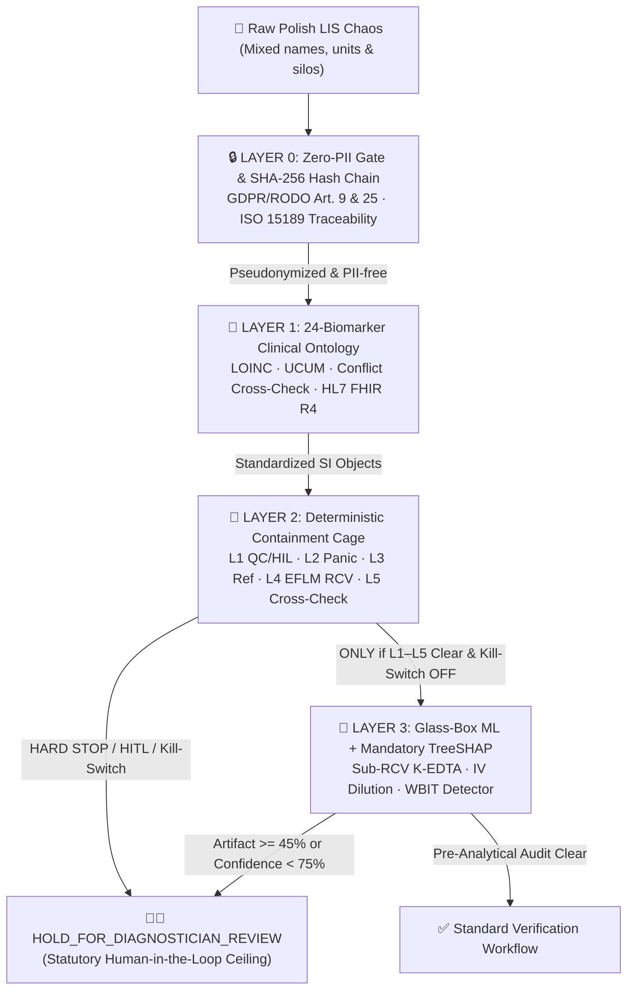

<div align="center">

# 🛡️ LabAegis

**Open-Source Clinical Ontology & Containment Engine for Laboratory Medicine**  
*Otwarta Ontologia Danych Laboratoryjnych i Architektura Powstrzymania dla Diagnostyki Medycznej*

[](https://github.com/MatthewJakubowski/LabAegis/actions/workflows/ci.yml)
[](https://github.com/MatthewJakubowski/LabAegis/releases)
[](https://www.python.org/)
[](LICENSE)
[](#architecture)
[](docs/COMPLIANCE_MATRIX.md)
[](https://mateusz-jakubowski.ai.studio/)


*"Don't use AI to replace clinical judgment; enclose AI inside a deterministic containment cage so humans stay safely in the loop."*

</div>

> [!WARNING]
> **LEGAL & MEDICAL DISCLAIMER (IVDR / EU AI Act / Polish Law):**  
> *LabAegis* is an open-source **research and educational framework** for pre-analytical data quality and semantic interoperability. It is **NOT** a certified *in-vitro* diagnostic medical device (IVDR Regulation (EU) 2017/746), contains **zero real patient data**, and must **not** be used for autonomous clinical diagnosis or laboratory result authorization. Provided **"AS IS"** under the [Apache License 2.0](LICENSE).

---

## 🎯 Why LabAegis Exists

Most healthcare AI initiatives fail long before the model is trained — because **laboratory data live in chaotic LIS silos** (inconsistent local test names, mixed units, disconnected pre-analytical context) and **opaque black-box models violate clinical safety and European law**.

**LabAegis** acts as an open, auditable **Clinical Data Trust & Containment Layer** positioned *before* any downstream analytics or AI:

* 🔓 **Breaks LIS Silos:** Translates messy Polish LIS dialects (`Potas [S] - CITO`, `ALP [µkat/L]`, `Hemoglobina (HGB) [g/L]`) into a strict **24-biomarker clinical ontology** (`LOINC` + `UCUM` + `HL7 FHIR R4`).
* 🧱 **Enforces Deterministic Containment:** Runs a 5-stage deterministic cascade (**L1–L5** + **EFLM RCV** metrological delta checks + **EU AI Act Art. 14 Kill-Switch**) *before* ML is ever allowed to execute.
* 🔬 **Glass-Box XAI for Silent Errors:** Uses classical tabular ML (`XGBoost` / `RandomForest`) with mandatory **TreeSHAP** attribution to catch sub-threshold multivariate artifacts (**Subtle K-EDTA**, **IV Fluid Dilution**, **WBIT**) when *every single analyte* still looks normal.
* 👩‍⚕️ **Human-in-the-Loop Ceiling:** Every flagged anomaly terminates at `HOLD_FOR_DIAGNOSTICIAN_REVIEW` — respecting the statutory authority of the Laboratory Diagnostician.

---

## 🏗️ Architecture



---

## 📊 Visual Proof & Benchmark

When every single analyte sits **inside the reference range AND below univariate EFLM RCV99**, Layer 3 surfaces the hidden multivariate signature and generates an auditable **TreeSHAP Card**:

| Model (Hold-Out Stratified Test Set, `n = 800`) | Macro F1 | Macro ROC-AUC | Role in LabAegis |
| :--- | :---: | :---: | :--- |
| **Logistic Regression** *(StandardScaler Pipeline)* | `0.9759` | `0.9980` | Linear interpretable baseline |
| **Random Forest** *(220 trees, Bagging)* | `0.9784` | `0.9978` | TreeSHAP-verified fallback |
| **XGBoost** *(Gradient Boosting)* | **`0.9810`** | **`0.9989`** | **Primary Glass-Box Champion** |


---

## 🚀 Quick Start

```bash
git clone [https://github.com/MatthewJakubowski/LabAegis.git](https://github.com/MatthewJakubowski/LabAegis.git)
cd LabAegis
pip install -e ".[dev]"
pytest -v
```

### Minimal Python Example (Layers 0 → 2 + HL7 FHIR R4)

```python
from labaegis import (
    AuditLedger,
    DeterministicContainmentCage,
    LabAegisOntology,
    SpecimenPreAnalyticalMeta,
    ZeroPIIGate,
)

ledger = AuditLedger()
gate = ZeroPIIGate(ledger)
ontology = LabAegisOntology(ledger)
cage = DeterministicContainmentCage(ontology, ledger)

# 1. Layer 0 (Zero-PII Gate) -> Layer 1 (Polish LIS -> LOINC / UCUM)
clean_rec = gate.ingest({
    "pseudonym_id": "PSEUDO_PL_0042",
    "specimen_id": "SPEC_2026_101",
    "raw_test_name": "Kreatynina [S]",
    "raw_value": 1.10,
    "raw_unit": "mg/dL",
    "collected_at_utc": "2026-11-20T20:00:00Z",
})
obs = ontology.harmonize(clean_rec)  # -> 97.24 umol/L [LOINC 14682-9]

# 2. Layer 2 (Deterministic Containment Cage L1–L5 + EFLM RCV)
verdict = cage.evaluate_panel([obs], meta=SpecimenPreAnalyticalMeta(), baseline_values={"CREA": 65.0})
print(verdict.final_status)          # -> DecisionStatus.HOLD_FOR_DIAGNOSTICIAN_REVIEW (Silent in-range drift!)
print(obs.to_fhir_r4()["resourceType"])  # -> "Observation"
print(ledger.verify_integrity())     # -> True (SHA-256 Hash Chain intact)
```

---

## 📜 Compliance & Governance Documentation

* **[Regulatory Compliance Matrix (PL / EU)](docs/COMPLIANCE_MATRIX.md)** — Direct code-to-law mapping for the Polish Laboratory Medicine Act (2022), EU AI Act (Art. 9, 12, 13, 14), GDPR/RODO (Art. 9, 25), ISO 15189:2022, and IVDR scope boundary.
* **[EU AI Act Model Card](docs/EU_AI_ACT_MODEL_CARD.md)** — Domain feature engineering (EFLM $CV_I / CV_A$), hold-out benchmarks, epistemic uncertainty floor, and Kill-Switch protocol.

---

## 🗺️ Roadmap (`v0.2.0`)

* [ ] Expanded hematology & coagulation ontology (`INR`, `APTT`, `D-Dimer`, `Ferritin`).
* [ ] Retrospective validation adapter for open clinical datasets (`NHANES` / `MIMIC-IV Demo`).
* [ ] Interactive **FastAPI + Streamlit** Human-in-the-Loop (HITL) diagnostician review workbench.

---

## 👤 Author, Portfolio & Newsletter

Created by **Mateusz Jakubowski** — *Bridge Builder* (Experimental Biology × 15+ years in Laboratory Medicine × Classical ML & Explainable AI).

* 🌐 **Main Portfolio:** [Mateusz Jakubowski | Portfolio & Bridge Builder](https://mateusz-jakubowski.ai.studio/)
* 📰 **Newsletter:** [From Pipette to Python](https://www.linkedin.com/newsletters/from-pipette-to-python-7502456754216247297) on LinkedIn
* 💻 **GitHub:** [@MatthewJakubowski](https://github.com/MatthewJakubowski)


## 📄 License

Released under the **[Apache License 2.0](LICENSE)** — enterprise-ready and open for academic, hospital, and MedTech collaboration.
