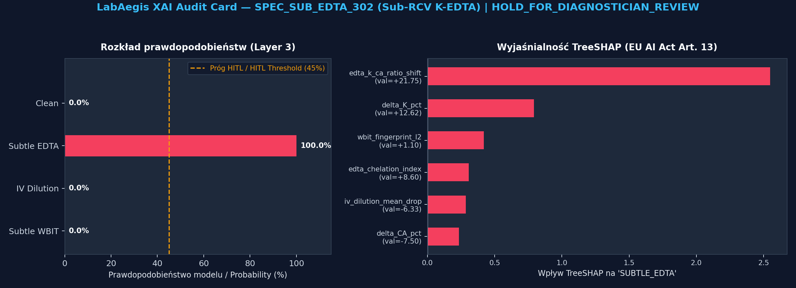
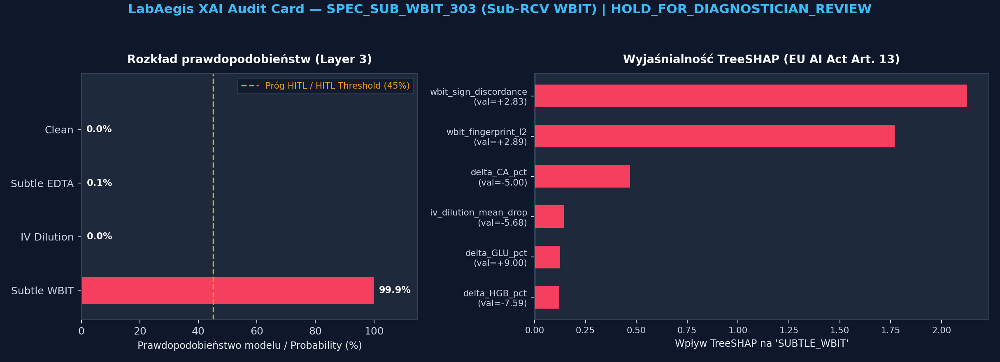

# LabAegis

> ⚠️ **LEGAL & MEDICAL DISCLAIMER (IVDR / EU AI Act / Polish Law):**  
> *LabAegis is an open-source research and educational framework for pre-analytical data quality and semantic interoperability. It is **NOT** a certified in-vitro diagnostic medical device (IVDR), contains **no real patient data**, and must **not** be used for autonomous clinical diagnosis or laboratory result authorization. Provided "AS IS" under Apache License 2.0.*


**Open-Source Clinical Ontology & Containment Engine for Laboratory Medicine**  
*Otwarta Ontologia Danych Laboratoryjnych i Architektura Powstrzymania dla Diagnostyki Medycznej*

> *"Don't use AI to replace clinical judgment; enclose AI inside a deterministic containment cage so humans stay safely in the loop."*  
> Built by **Mateusz Jakubowski** — *From Pipette to Python* (Bridge Builder: Experimental Biology × Laboratory Medicine × Classical ML/XAI).

---

## Why LabAegis Exists (The Silo & Black-Box Problem)

Modern healthcare AI projects fail not because algorithms are weak, but because **laboratory data live in chaotic LIS silos** (inconsistent local test names, mixed units, disconnected pre-analytical context) and **black-box models violate clinical safety**.

**LabAegis** acts as an open, auditable **Clinical Data Trust & Containment Layer** positioned *before* any downstream analytics or AI:

```text
[Raw Polish LIS Chaos]
        │
        ▼
┌─────────────────────────────────────────────────────────────┐
│ LAYER 0: Zero-PII Gate & SHA-256 Audit Hash Chain           │  ◄── GDPR/RODO Art. 9 & 25, ISO 15189
└─────────────────────────────────────────────────────────────┘
        │ (Pseudonymized, PII-free)
        ▼
┌─────────────────────────────────────────────────────────────┐
│ LAYER 1: 24-Biomarker Clinical Ontology (Silo Breaker)      │  ◄── LOINC, UCUM, HL7 FHIR R4 Export
│ • Deterministic Polish LIS parsing & conflict cross-check   │
│ • Pre-analytical vulnerability graph (HIL, EDTA, WBIT)      │
└─────────────────────────────────────────────────────────────┘
        │ (Standardized SI Objects)
        ▼
┌─────────────────────────────────────────────────────────────┐
│ LAYER 2: Deterministic Containment Cage (L1–L5 + EFLM RCV)  │  ◄── Mustafa Suleyman Containment
│ • L1 QC/HIL  • L2 Panic  • L3 Ref  • L4 EFLM RCV  • L5 EDTA │      EU AI Act Art. 14 Kill-Switch
└─────────────────────────────────────────────────────────────┘
        │ (ONLY if L1–L5 Clear & Kill-Switch OFF)
        ▼
┌─────────────────────────────────────────────────────────────┐
│ LAYER 3: Glass-Box ML + Mandatory TreeSHAP (Sub-RCV Guard)  │  ◄── EU AI Act Art. 13 (XAI)
│ • Detects Subtle K-EDTA, IV Dilution & WBIT inside normal   │      Polish Lab Medicine Act (HITL)
│   reference ranges & below univariate RCV99 thresholds      │
└─────────────────────────────────────────────────────────────┘
        │
        ▼
  [HOLD_FOR_DIAGNOSTICIAN_REVIEW]  (Human-in-the-Loop Ceiling)
```

---

## Visual Proof: Catching Silent Artifacts Inside Normal Ranges

When every single analyte sits **inside the reference range AND below univariate EFLM RCV99**, Layer 3 (`XGBoost` + `TreeSHAP`) surfaces the hidden multivariate signature and escalates to the diagnostician with full attribution:




---

## Quick Start

```bash
pip install -e ".[dev]"
pytest -v
```

## Compliance & Governance Documentation
* **[Regulatory Compliance Matrix (PL / EU)](docs/COMPLIANCE_MATRIX.md)** — Mapping to Polish Laboratory Medicine Act (2022), EU AI Act, GDPR/RODO, ISO 15189:2022, and IVDR scope boundary.
* **[EU AI Act Model Card](docs/EU_AI_ACT_MODEL_CARD.md)** — Features, benchmarks, epistemic uncertainty floor, and Kill-Switch protocol.

## License
Released under the **Apache License 2.0** — enterprise-ready and open for academic, hospital, and MedTech collaboration.
